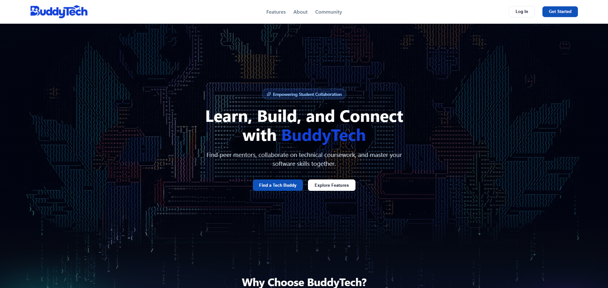
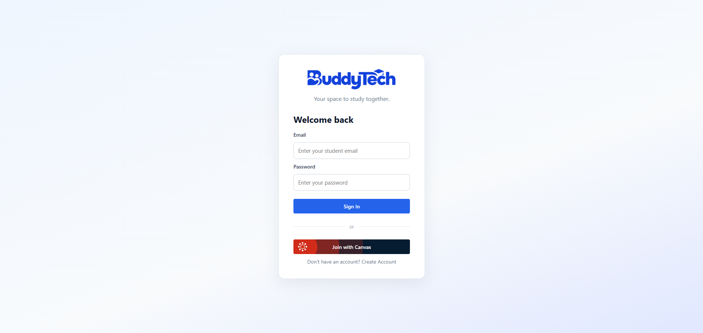
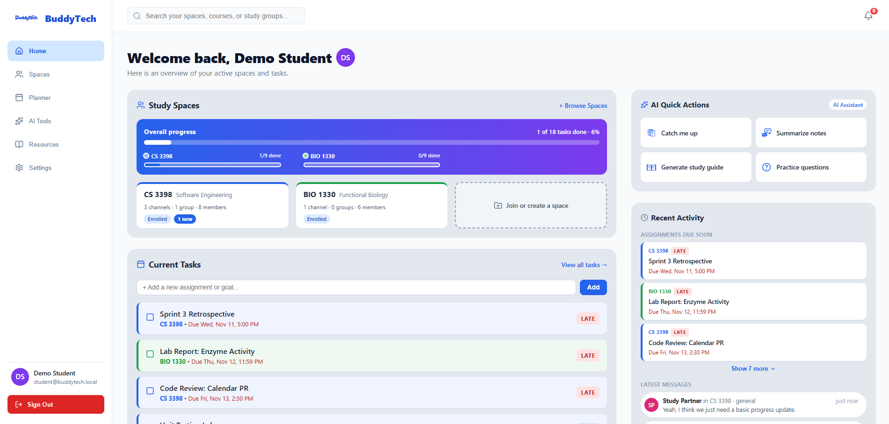

# BuddyTech

BuddyTech is a student-focused academic collaboration platform built with React, Express, and MySQL.

Students chat in their courses ("Study Spaces"), find and connect with classmates ("Study Partners"), message each other directly, organize small study groups, keep a planner that can sync to Google Calendar, and use Gemini-powered AI study tools. Teachers and TAs can see and take part in every study group in the courses they teach, and teachers share course resources (links and files).

## Screenshots

**Landing page**

**Sign in**

**Home dashboard** (signed in as the Demo Student account)

## Live Version

The publicly hosted version of BuddyTech is at **https://buddytechdemo.devs.li**.

To run your own copy locally, use [Local Development with Docker](#local-development-with-docker) (the easiest way: only Docker needed) or the [Native Development Setup](#native-development-setup). The repository has two Docker setups:

| File | For | Start with |
| --- | --- | --- |
| `docker-compose.dev.yml` | your own computer (development) | `docker compose -f docker-compose.dev.yml up --build` |
| `docker-compose.yml` | the hosted server (production, HTTPS) | `docker compose up -d --build` |

Backend setup, database, permissions, sign-in sessions, real-time events, and the full API list: [`BuddyTech/Backend/README.md`](BuddyTech/Backend/README.md)

## Local Development with Docker

`docker-compose.dev.yml` runs the whole app on your own computer: MySQL, the backend, and the **Vite dev server**, which reloads the page as soon as you save a file in `Frontend/`. You only need **Git** and **Docker Desktop** (no Node.js or MySQL install). See the Windows tip under [Requirements](#requirements) if PowerShell can't find `docker`.

### 1. Clone and start

    git clone https://github.com/lukene1son/CS-3398-Team-6.git
    cd CS-3398-Team-6
    docker compose -f docker-compose.dev.yml up --build

**No `.env` file is needed.** The database password and `JWT_SECRET` have local-only defaults, and the Google, Gemini, and email settings are optional: without them, those features are turned off (the **Sign in with Google** button is hidden, Calendar sync says it isn't configured, the AI tools say they aren't set up, and sign-in approval emails are skipped; approve sign-ins from the bell instead).

The first launch takes a few minutes. Docker builds the images, creates the database, loads the demo data (see the demo accounts under [Current Development Status](#current-development-status); password `password123`), and starts everything. It's ready when the log shows `Server running on port 3000` and `VITE ... ready`.

> **Shortcut:** add the line `COMPOSE_FILE=docker-compose.dev.yml` to a root `.env` file (git-ignored), and plain `docker compose up --build` uses the dev setup from then on. Every command below can then drop the `-f docker-compose.dev.yml` part.

### 2. Open BuddyTech

- Site: http://localhost:5173
- Backend API (for testing it directly, e.g. with Postman): http://localhost:3000

Both are published on `127.0.0.1` only, so they're reachable from your own computer but not from other devices on your network.

### Editing code

- **Frontend (`Frontend/`):** your folder is shared with the container, so saved changes show up in the browser right away. No restart needed.
- **Backend (`BuddyTech/Backend/`):** the backend runs from its image, so rebuild after changing it:

      docker compose -f docker-compose.dev.yml up --build

- **New npm packages:** after you (or a teammate) change `Frontend/package.json` / `package-lock.json`, run the same `up --build`. The frontend reinstalls its packages only when `package-lock.json` changed.

### Logs and stopping

    docker compose -f docker-compose.dev.yml logs backend --tail 100
    docker compose -f docker-compose.dev.yml down

Your local database and uploaded files are kept in Docker volumes between runs. To erase them and reload fresh demo data:

    docker compose -f docker-compose.dev.yml down -v
    docker compose -f docker-compose.dev.yml up --build

### Optional settings

To try the optional features locally, create a root `.env` file with any of the settings listed in [Create the root `.env` file](#2-create-the-root-env-file) below. For Google Calendar sync, use `GOOGLE_REDIRECT_URI=http://localhost:5173/api/auth/google/callback` and add that address to your Google Cloud OAuth client. `APP_URL` is always `http://localhost:5173` in the dev setup.

**Troubleshooting:** if the backend log shows `Access denied for user 'root'`, your database volume was created with a different `MYSQL_ROOT_PASSWORD` than the one in use now. Either set the old password in `.env`, or erase the local database with `down -v` as above.

## Hosting with Docker

`docker-compose.yml` runs the whole site on one server: MySQL, the backend, the frontend, and **Caddy**, a web server that gets an HTTPS certificate automatically and passes requests on (`/api/*`, including Socket.IO, to the backend; everything else to the frontend). Only Caddy is reachable from outside, on ports 80 and 443; the backend and frontend have no published ports.

The site address is set in the `Caddyfile` at the repository root (`buddytechdemo.devs.li`). For your own server, change it to your domain and point that domain's DNS at the server before starting, so Caddy can get the certificate.

> **Running Docker on your own computer:** don't use `docker-compose.yml` locally. It publishes no `localhost:5173` or `localhost:3000`, and Caddy only answers for the domain in the `Caddyfile` (it would also keep trying to get that domain's certificate from your computer). Use [Local Development with Docker](#local-development-with-docker) instead.

### Requirements

On the server, install:

- Git
- Docker with the Compose plugin (Docker Engine on a Linux server, or Docker Desktop)

You do not need to install Node.js or MySQL separately when using Docker. The server must accept connections on ports 80 and 443.

> **Windows tip:** if PowerShell says `docker : The term 'docker' is not recognized`, Docker Desktop is installed but its command-line folder isn't on your `PATH`. For a per-user install, add `%LOCALAPPDATA%\Programs\DockerDesktop\resources\bin` to your user `PATH`, then restart your terminal (and VS Code, if you use its terminal).

### 1. Clone the repository

    git clone https://github.com/lukene1son/CS-3398-Team-6.git
    cd CS-3398-Team-6

### 2. Create the root `.env` file

Docker reads a `.env` file in the repository root (it is git-ignored). **`JWT_SECRET` is required**: `docker compose up` stops with `Set JWT_SECRET in the root .env file` if it's missing. Everything else is optional and turns on an extra feature:

    # Required: signs login tokens. Any long random string.
    JWT_SECRET=any-long-random-string

    # Optional: AI study tools
    GEMINI_API_KEY=your-google-ai-studio-key
    GEMINI_MODEL=gemini-3.5-flash-lite

    # Optional: "Sign in with Google" (needs only the client ID)
    GOOGLE_CLIENT_ID=your-client-id.apps.googleusercontent.com

    # Optional: Google Calendar sync (needs all four)
    GOOGLE_CLIENT_SECRET=your-client-secret
    GOOGLE_REDIRECT_URI=https://buddytechdemo.devs.li/api/auth/google/callback
    GOOGLE_TOKEN_KEY=64-hex-characters

    # Optional: security emails ("approve this sign-in"), sent through Resend
    EMAIL_API_KEY=your-resend-api-key
    MAIL_FROM=BuddyTech <security@your-verified-domain>

    # The site's public address, used for links in emails (this is the default)
    APP_URL=https://buddytechdemo.devs.li

To generate `JWT_SECRET` or `GOOGLE_TOKEN_KEY`:

    node -e "console.log(require('crypto').randomBytes(32).toString('hex'))"

Never commit this file. See the backend README for what each Google setting does.

### 3. Start BuddyTech

On the server, from the repository root:

    docker compose up -d --build

On the first launch Docker will:

- download the required images
- build the frontend and backend
- start MySQL
- create the BuddyTech database and tables
- load demo data (accounts, courses, study groups, assignments, resources, and profile pictures)
- start the Express backend and the React frontend
- start Caddy, which gets the HTTPS certificate for the site address

On every start, the backend also runs `npm run db:migrate`, which applies any new files in `BuddyTech/Backend/database/migrations/` without touching existing data.

### 4. Open BuddyTech

    https://buddytechdemo.devs.li

(or the domain you put in the `Caddyfile`).

### Updating, logs, and stopping

After pulling new code, rebuild and restart:

    docker compose up -d --build

Backend logs:

    docker compose logs backend --tail 100

Stop everything:

    docker compose down

Your database, uploaded files (profile pictures, course resources), and Caddy's certificates are stored in Docker volumes, so they remain available the next time you start it.

### Resetting the Database

To rebuild the database and reload the demo data while the site is running:

    docker compose exec backend npm run db:init

To erase **everything** (database, uploads, and certificates) and start fresh:

    docker compose down -v
    docker compose up -d --build

Only use the `-v` option when you intentionally want to erase BuddyTech data.

**When to reset:** demo data (`seed.sql`) is only loaded into an **empty** database. If someone changes `seed.sql`, you won't see the new demo data until you reset. The backend log says `Database "buddytech" already initialized.` when it skipped the seed, and `Database initialized successfully.` when it loaded it. If the log shows `Database setup failed` with an SQL error, fix `seed.sql` and reset again (the failed run leaves empty tables behind).

## Native Development Setup

This runs BuddyTech on your own computer without Docker (you install Node.js and MySQL yourself). For the Docker way, see [Local Development with Docker](#local-development-with-docker).

### Backend

Requirements:

- Node.js
- MySQL

From the repository root:

    cd BuddyTech/Backend
    cp .env.example port.env
    npm ci

The backend reads its settings from `BuddyTech/Backend/port.env` (git-ignored). Edit it if your MySQL username or password differs from the defaults, and set `JWT_SECRET` (required). The AI and Google settings are optional; see the backend README.

Initialize the database if necessary:

    npm run db:ensure

Apply any new schema changes:

    npm run db:migrate

Verify the database:

    npm run db:verify

Start the backend:

    npm start

For development with automatic restart:

    npm run dev

### Frontend

Open another terminal from the repository root:

    cd Frontend
    npm ci
    npm run dev

Then open:

    http://localhost:5173

Other frontend commands: `npm run build` (production build in `Frontend/dist`) and `npm run lint` (ESLint).

## Database Commands

Run these from `BuddyTech/Backend`.

### Safe initialization

    npm run db:ensure

Creates and seeds the BuddyTech database only if it has not already been initialized, and copies the demo files (profile pictures and resource files) into `uploads/`.

### Migrations

    npm run db:migrate

Applies new `database/migrations/*.sql` files in order and remembers which ones ran (in a `schema_migrations` table), so it is safe to run repeatedly. Docker runs it on every start.

### Verification

    npm run db:verify

Displays database table counts and sample records. Changes nothing.

### Full reset

    npm run db:init

This completely rebuilds and reseeds the BuddyTech database.

Warning: `db:init` deletes existing BuddyTech table data.

## Current Development Status

BuddyTech is under active development.

Working now:

- **Accounts:**
  - Sign up and sign in with an email and password. Passwords are hashed with bcrypt, and the backend issues a login token that lasts 7 days, so you stay signed in after a browser refresh.
  - **Sign in with Google** (when `GOOGLE_CLIENT_ID` is set). A new Google user gets an account automatically. An existing password account with the same email is linked to Google only if Google vouches for the address (a `@gmail.com` address, or a verified Google Workspace address); otherwise the user is asked to sign in with their password. Linking removes the account's password and signs out its other devices, so from then on it signs in with Google (someone could have registered the address with a password before its real owner arrived).
  - **Canvas course launch** pilot. A configured LTI 1.3 course can open a mapped BuddyTech Space after BuddyTech sign-in and account linking. See the [local simulator and Canvas setup](BuddyTech/Backend/CANVAS_LTI.md).
- **Sign-in sessions and approval:**
  - Every login token belongs to a session the server keeps track of. **Sign Out** ends that session on the server, so the token stops working right away (not just in this browser).
  - **New sign-ins need approval while you're signed in elsewhere.** If someone signs in to your account while you have BuddyTech open on another device, the sign-in is held: the new device shows a **Waiting for approval** screen, and your open app gets a bell notification, "**Sign-In attempt:** *device* (*IP address*). Was this you?" with ✓ / ✗. ✓ lets the other device in (it checks every 3 seconds); ✗ refuses it. You have 10 minutes to decide. If email is set up, you also get an email about it.
  - If you don't have the app open anywhere, a correct password signs in normally.
- **Private data:** every `/api` route (except sign-in, sign-up, the waiting device's approval check, and the Google Calendar callback) requires a login token for a live session. Users only see courses they belong to, plus their own personal tasks and task status.
- **Course roles:** each course member is a student, TA, or teacher. Only TAs and teachers can post assignments for the whole course; students can add personal tasks.
- **Home tab:**
  - Your upcoming tasks. Check them off; each user's check-offs are saved separately. A task shows **LATE** once its due time passes, or if it was checked off after its due time; one finished on time doesn't.
  - A **search bar** (not connected yet; see the limitations below).
  - A **Recent Activity** card with the newest messages from your channels, groups, and direct messages, plus newly posted course assignments.
- **Notification bell:** sign-in attempts waiting for your approval, incoming study partner requests and study group invites (all with ✓ / ✗), requests of yours that were accepted, and unread messages in study groups, direct messages, and course channels. Clicking an unread chat opens it in Spaces. The Spaces sidebar shows a red dot on each chat with unread messages; it keeps pulsing until you've seen that notification in the bell.
- **Spaces tab:** three sub-tabs.
  - **Chat:** one place for every conversation, with a collapsible sidebar:
    - **Study Spaces:** members of a course chat in its channels.
    - **Study Groups:** the groups you belong to (and, for teachers/TAs, every group in the courses they teach), each with `#general`, `#homework`, and `#meetups` channels.
    - **Direct Messages:** one-to-one chats with your connections.
    - Every message shows the sender's profile picture. The header shows the people in the open space or group (up to 15, then a **…** list of the rest). Clicking someone opens a card with **Message** and **Invite to group** if you're connected, or **Request** / **Requested** / **Accept request** if you're not.
    - **Real-time:** new messages, friend requests, invites, and unread counts arrive instantly over WebSockets (Socket.IO). The app still re-checks in the background as a safety net.
  - **Study Partners:**
    - **My Connections:** the classmates you've connected with, with **Message**, **Invite to group**, and **Remove**, followed by **Study Partner Invites** (requests other students sent you) with **Accept** / **Decline**.
    - **Find Study Partners:** your sent **Study Partner Requests** (with **Cancel**), then suggested classmates who share a course with you, each with a **Request** button.
  - **Study Groups:**
    - **Discover:** every public study group in your courses, with its members' pictures, a course filter and search, **Join** / **Joined ✓**, and **+ Create Group**.
    - **Public or private groups:** public groups show in Discover and any student in the course can join. Private groups never show in Discover; students join only by accepting an invite.
    - **Invites:** study group invitations sent to you, showing the group's members, with **Accept** / **Decline**.
    - Only students can create, join, or be invited to a group, and only within a course they're in. Teachers and TAs don't join groups; they can already read and post in every group (public or private) in the courses they teach (shown as "Teaching").
- **Direct messages are private:** only the two people in a conversation can read it (not even teachers), and you can only message people you're connected with.
- **Planner tab:** a month calendar of your course assignments and personal tasks (with due times), and **Add Task** for personal tasks (teachers and TAs can post course-wide assignments).
  - **Google Calendar sync** (when the Google Calendar settings are set): connect your Google account and BuddyTech copies your assignments into a separate "BuddyTech" calendar in your Google account. It's one-way, and BuddyTech can only touch calendars it created. New course assignments are pushed automatically after your first sync.
- **AI Tools tab:** AI study tools go through the backend (`POST /api/ai/chat`, powered by Gemini) when `GEMINI_API_KEY` is set.
- **Resources tab:** each course's shared links and files (PDFs, Office documents, images, zip files, and source code up to 20 MB). Everyone in the course can view and download them; only the course's teachers can add or delete them.
- **Settings tab:**
  - Change your display name (once a month).
  - Upload a profile picture (PNG, JPEG, WebP, or GIF, up to 3 MB, no transparent background) or remove it, and pick the background color for your initials avatar.
  - Only you, your classmates, and your connections can see your picture.
  - Email notification and assignment reminder switches (saved, but see the limitations below).
- **Rate limiting:**
  - **Sign-in:** after 5 wrong passwords for one email, sign-in for that account is blocked for 15 minutes (only wrong passwords count). Each account can have at most 5 held sign-ins per hour that weren't approved. Each IP address can create at most 10 accounts per hour.
  - **Chat:** each user can send 15 messages per 30 seconds, across course channels, study groups, and direct messages together.
  - **Study partners and groups:** each user can send 20 friend requests per hour (3 per day to the same person), 30 study group invites per hour, and 30 user searches per minute. Failed attempts don't count.
  - **Settings and sync:** 3 profile picture uploads per 15 minutes, and 10 Google Calendar syncs per 15 minutes.

Demo accounts (created with the seed data, password `password123`):

| Email | Who | Courses |
|---|---|---|
| `student@buddytech.local` | Demo Student | CS 3398, BIO 1330 |
| `partner@buddytech.local` | Study Partner | CS 3398 |
| `teacher@buddytech.local` | Demo Teacher | CS 3398 (teacher) |
| `teacher2@buddytech.local` | Demo Teacher2 | BIO 1330 (teacher) |
| `partner1@buddytech.local` | Study Partner1 | CS 3398 (TA) |
| `partner2@buddytech.local`, `partner3@buddytech.local` | Study Partner2–3 | CS 3398 |
| `partner4@buddytech.local`, `partner5@buddytech.local` | Study Partner4–5 | CS 3398, BIO 1330 |
| `partner6@buddytech.local`, `partner7@buddytech.local` | Study Partner6–7 | BIO 1330 |

The seed data also includes:

- five study groups (three in CS 3398, two in BIO 1330); **Software Engineering Project Group** is private
- some connections between the accounts, and a pending friend request in each direction for Demo Student
- two study group invites waiting for Demo Student
- a few channel, group, and direct messages
- 18 assignments across both courses
- 10 course resources (links and files)
- animated profile pictures for Study Partner1–5

Demo Student, Study Partner, and Study Partner2 are all in **CS 3398 Exam Prep**.

Known limitations:

- **New accounts start in no space.** Signing up (with a password or with Google) doesn't add the user to any course. After signing up, use **Join or create a space** on the dashboard: type a space's join code to join it, or create your own (you become its administrator and get a code to share). Members can see their spaces' codes there. The demo spaces' codes are `CS3398DEMO` and `BIO1330DEMO` (published in this repository, so don't treat them as secret). A signed-in user can guess codes only slowly: 15 wrong tries per 15 minutes.
- **`JWT_SECRET` must be set.** Natively, the backend reads it from `BuddyTech/Backend/port.env`; without it, sign-in and sign-up fail with a server error. The hosted Docker setup (`docker-compose.yml`) refuses to start until the root `.env` sets it; the local Docker setup (`docker-compose.dev.yml`) uses a local-only default instead.
- **Google features need a Google Cloud OAuth client.** Without `GOOGLE_CLIENT_ID`, the **Sign in with Google** button is hidden. Without all four Google Calendar settings, the Planner's sync card says sync isn't configured.
- **Google Calendar sync is one-way.** Changes made in Google Calendar don't come back to BuddyTech, and disconnecting leaves the "BuddyTech" calendar in your Google account.
- **The email notification and assignment reminder switches don't send anything yet.** They are saved, but the only email the backend sends is the sign-in approval email.
- **The sign-in approval email's link doesn't work yet.** It points to a `/login-attempt` page the frontend doesn't have. Approve from the bell instead. (Without `EMAIL_API_KEY` and `MAIL_FROM`, no email is sent at all.)
- **The Home tab's search bar doesn't search yet.** The backend has a search route (`GET /api/me/search`, messages and assignments you can see), but the search box isn't connected to it.
- **Changing your password and "sign out everywhere" have no buttons yet.** The backend routes exist (`PUT /api/me/password`, `POST /api/me/logout-everywhere`), but the Settings tab doesn't use them.
- **Everyone had to sign in again once** after sessions were added: login tokens from before then have no session and are refused.
- **A new direct message only appears for the other person once something is sent.** Clicking **Message** opens an empty chat for you right away, but nothing is saved until the first message.
- **Study groups have three fixed channels** (`#general`, `#homework`, `#meetups`).
- **Invite pickers list every group you can post in.** The app doesn't know which courses a connection is in, so if you pick a group they can't join, the backend refuses and explains why.
- **Teachers and TAs show up in Find Study Partners suggestions,** because suggestions are based on shared courses, not roles.
- **Rate-limit counts, the Google Calendar sync queue, and "who has the app open" reset on restart.** They are kept in the backend's memory, which only works while a single backend server is running.
- **The hosted Docker setup still has demo-grade parts:**
  - the demo accounts use a password that is published in this repository
  - the backend connects to MySQL as the root user
- **The local Docker setup doesn't hot-reload the backend.** Frontend edits show up live, but backend changes need `docker compose -f docker-compose.dev.yml up --build`.
- **AI tools need a Gemini API key.** Without `GEMINI_API_KEY`, the AI route returns "AI service is not configured yet".

## Technology Stack

- React 19 + Vite
- Node.js + Express 5
- MySQL 8
- Socket.IO (real-time updates)
- Google Identity Services (Sign in with Google) and the Google Calendar API
- Gemini (AI study tools)
- Resend (sign-in approval emails)
- Docker / Docker Compose: `docker-compose.dev.yml` for local development, `docker-compose.yml` with Caddy (HTTPS and routing) on the hosted server
